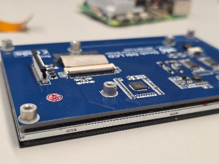
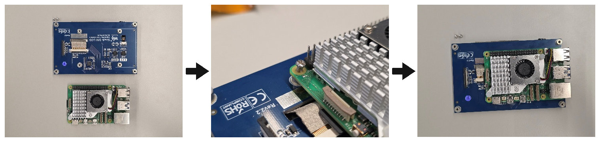
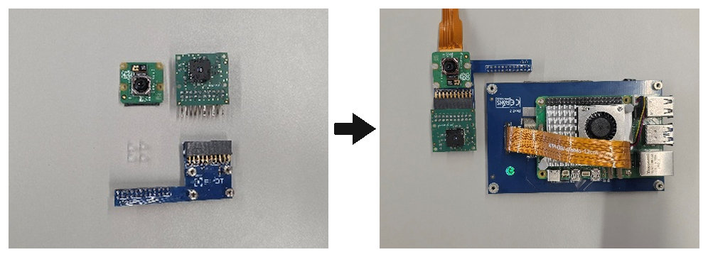
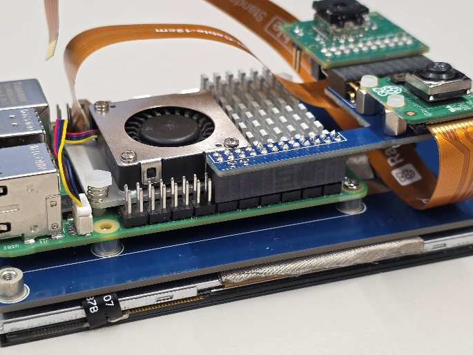
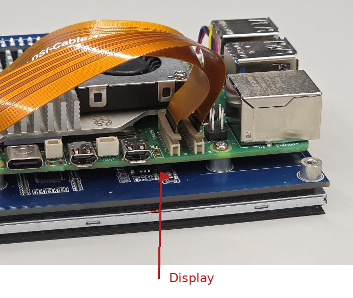
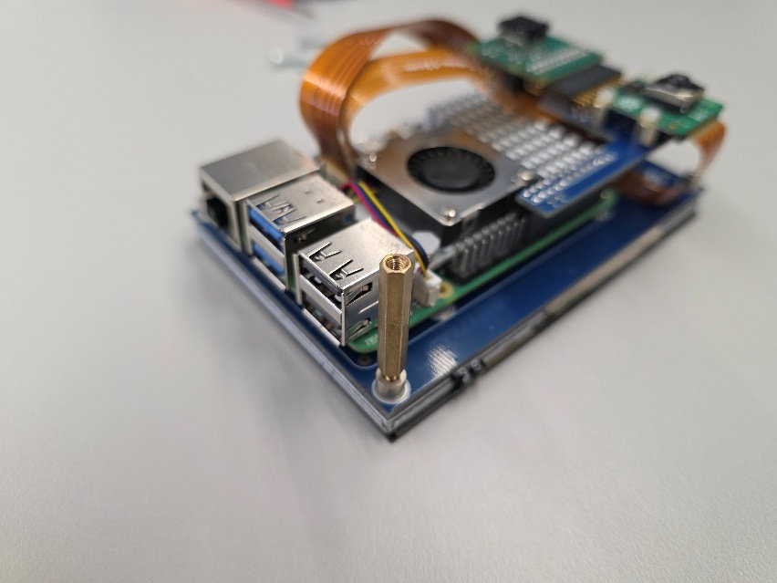
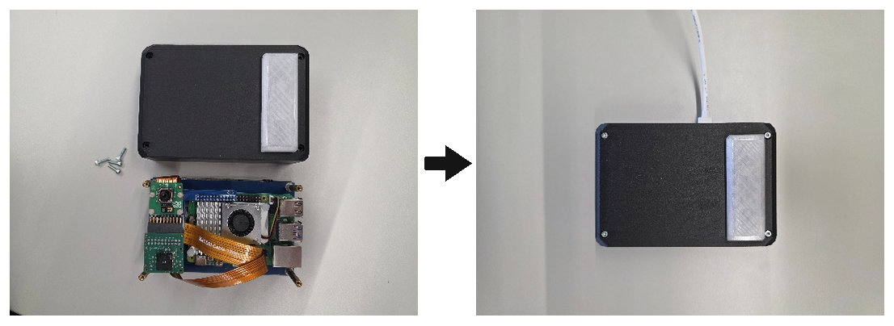

# SPOT – Assembly Instructions

## Prerequisites

Have all components listed in the [Bill of Materials](../BOM.md) ready. Install the FLIR Lepton 3.5 sensor into the Lepton Breakout Board v2 before starting. Refer to the official FLIR documentation if needed.

## Step 1: Prepare the display

Unpack all components and lay them out on a table. Remove the spacers from the back of the display, as shown.

## Step 2: Install the Raspberry Pi 5

Mount the Raspberry Pi 5 on the back of the display using the included screws.

## Step 3: Assemble the connector PCB

Assemble the connector PCB using the plastic screws and brass spacers, then connect the ribbon cables to the Pi Camera Module 3 and the display.

## Step 4: Attach the connector PCB

Attach the assembled connector PCB to the Raspberry Pi 5. Align it with the outermost GPIO pins to avoid short circuits.

## Step 5: Connect the ribbon cables

Connect the ribbon cables from the Pi Camera Module 3 and the display to the Raspberry Pi 5. The display cable connects to the left-hand connector, as shown.

## Step 6: Install the standoffs

Attach the long standoffs at the corners of the display.

## Step 7: Fit the enclosure

Insert the assembly into the 3D-printed case and secure it with four M2.5 × 14 mm screws. Depending on the print tolerances, a snug fit may require some gentle pressure.

## Step 8: Install the camera cover magnets

The camera cover has recesses for 6 × 3 mm magnets. Secure the magnets with an adhesive suitable for plastic. Check their polarity before gluing them in place.
