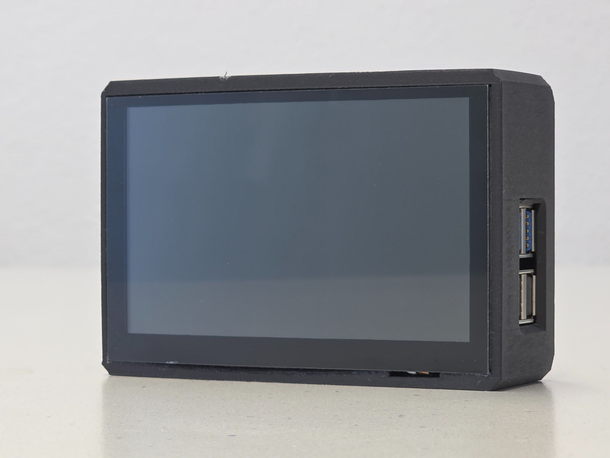
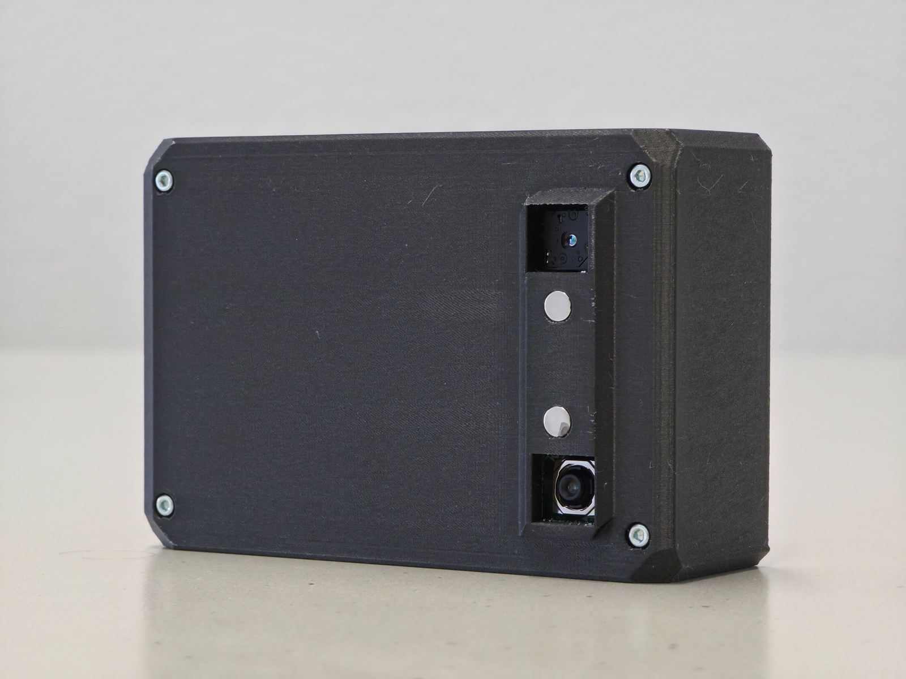
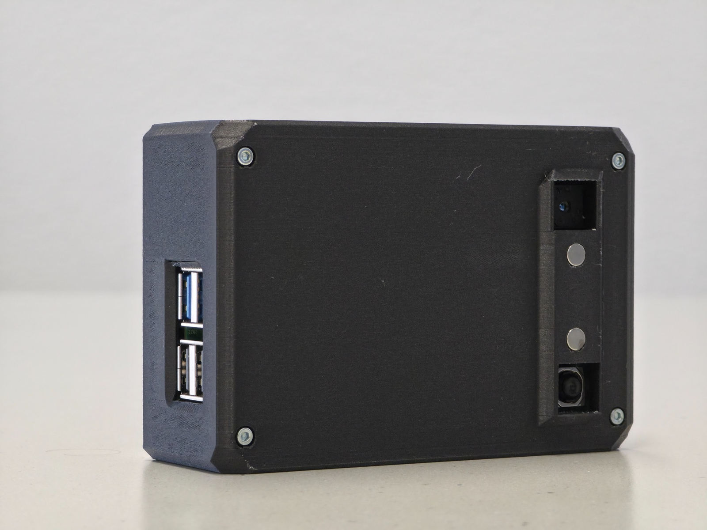
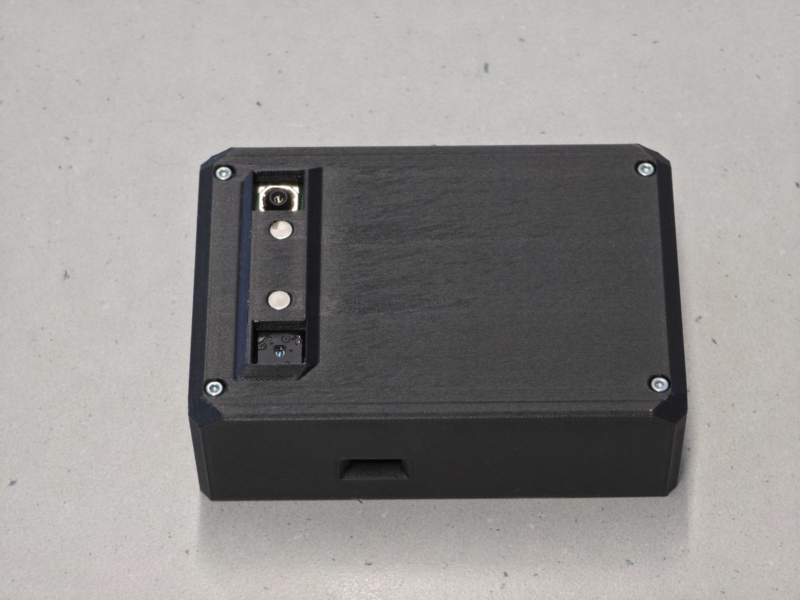
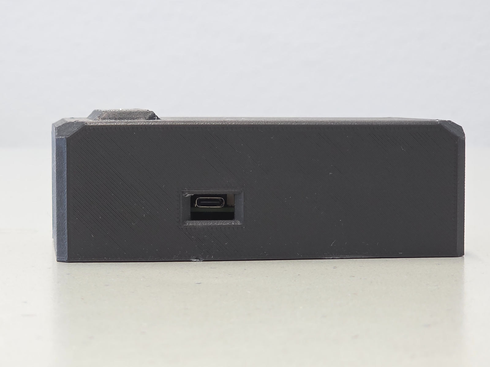

# SPOT – Hardware Photos

Photographs of the assembled SPOT prototype. All images show the actual device.

| View | Photo |
| --- | --- |
| Display side |  |
| Sensor side |  |
| Sensor side and USB ports |  |
| Top view |  |
| USB-C power port |  |
