# SPOT User Manual

SPOT App **0.31.1** · SPOT OS **0.1.7** · **800 × 480** touchscreen

The instructions use the German control labels shown on the device, with English explanations. Temperatures are displayed in °C.

1. [Overview and navigation](#1-overview-and-navigation)
2. [Live view](#2-live-view)
3. [Capturing images and videos](#3-capturing-images-and-videos)
4. [Display, measurement and device settings](#4-display-measurement-and-device-settings)
5. [Gallery](#5-gallery)
6. [Image analysis](#6-image-analysis)
7. [Temperature history](#7-temperature-history)
8. [Saved measurements](#8-saved-measurements)
9. [Transfer to a computer](#9-transfer-to-a-computer)
10. [Software updates](#10-software-updates)
11. [Power and energy saving](#11-power-and-energy-saving)

## 1. Overview and navigation

The right sidebar switches between **Gallery** (top, stacked pictures), **Home / live view** (centre, house) and **Settings** (bottom, gear). Tap an icon or drag the selector vertically to the adjacent screen.

On Home, **double-tap the house** to open the recording controls. **Hold the house for about 0.7 seconds** to open the power menu. A back arrow returns to the preceding page. Scroll lists and settings panels vertically to reveal further controls.

Settings contains six tiles: **Messeinstellungen** (measurement settings), **Palette**, **Speicher** (storage), **Netzwerk** (network), **Messungen** (saved measurements) and **Software-Updates**.

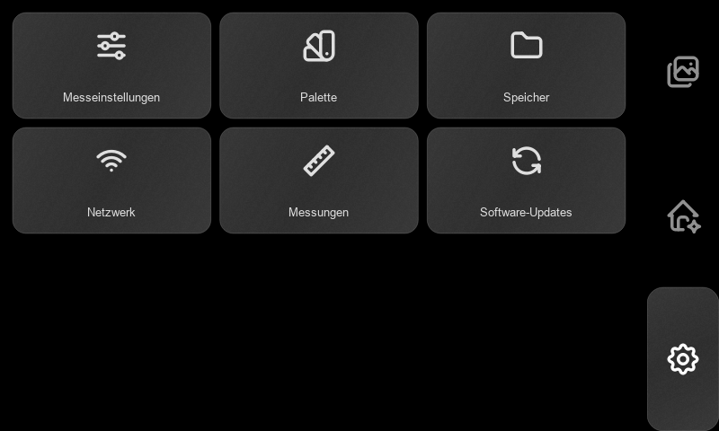

## 2. Live view

Home displays the thermal image. The colour scale maps temperature to the selected palette. Its expanded panel shows the upper and lower scale limits and **MED**, the scene median. The lower-left values box shows the enabled measurements.

The left toolbar, from top to bottom:

| Control | Operation |
|---|---|
| Pointer | Enable a spot measurement, then tap the thermal image. The square marker and **Punkt** value follow the selected sensor pixel. Tap the control again to disable it. |
| Extrema | Cycle through minimum, maximum, both, and off. Blue marks the cold position; red marks the hot position. |
| Scale | Expand or collapse the temperature scale. |
| Split rectangle / PbP | Toggle picture-by-picture: thermal on the left, RGB on the right. Tap again for the full thermal view. |

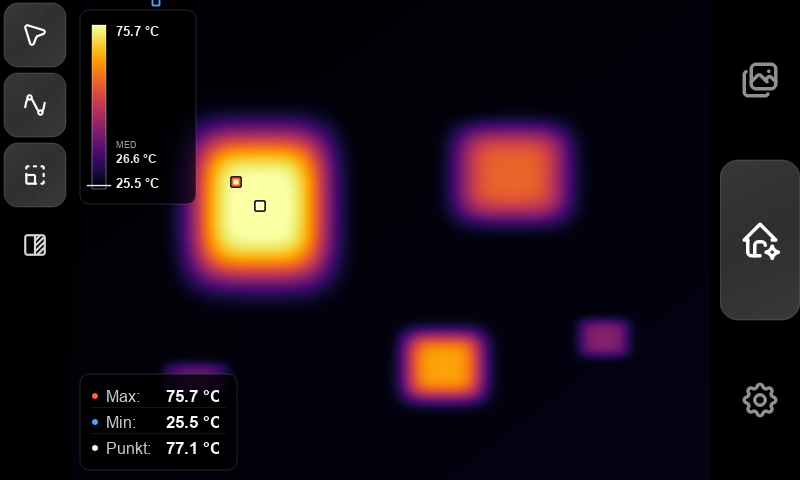

In Auto scale, the extrema markers follow the displayed scale limits; in fixed scale they follow the scene minimum and maximum. **Punkt** always reads the selected original thermal sensor pixel. RGB provides visual context; temperature readings come from the thermal image.

When a camera status message replaces readings, wait for the camera to become ready before capturing a thermal measurement.

## 3. Capturing images and videos

1. Open **Home**, select the desired palette and view, then **double-tap the house**.
2. Press the **camera** icon (**1**) to capture a photo. SPOT saves a thermal image, the radiometric sensor data, capture settings and an RGB photo as one recording. Wait for the saving message to clear.
3. Press the **video camera** (**2**) to start recording. The recording indicator and elapsed time appear on the image. Press it again to stop and finish the MP4.
4. Press the **back arrow** at the top right to leave recording mode. Leaving this mode also stops an active video.

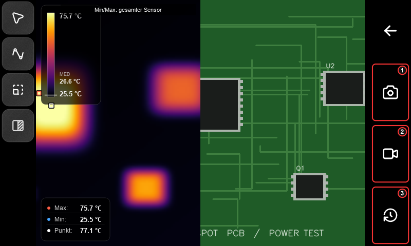

Video records the displayed camera viewport, including thermal overlays and the RGB half when PbP is enabled. Select PbP **before** starting; the split layout is locked during recording. Use a temperature history for numerical temperature-versus-time data.

The bottom-right **clock/history** icon (**3**) starts the [temperature-history setup](#7-temperature-history). Open **Gallery** after leaving recording mode to review saved content.

## 4. Display, measurement and device settings

### Thermal palette

Open **Settings → Palette** and tap **Iron**, **Rainbow**, **HotWhite** or **HotBlack**. The selection applies to the live image. HotWhite displays hotter areas brighter; HotBlack displays them darker. Changing the palette changes the colours, not the measured temperatures.

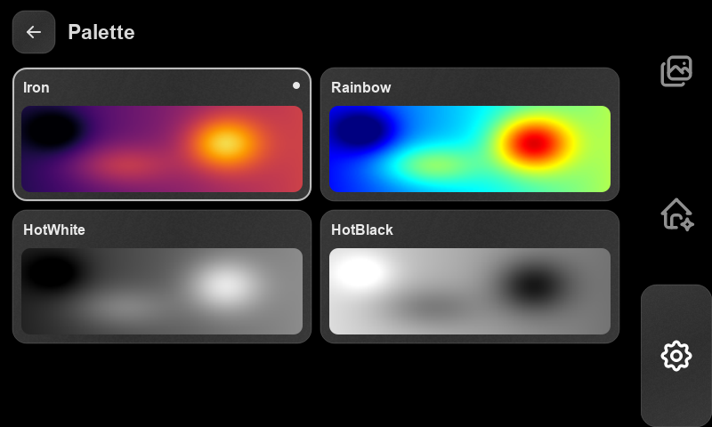

### Measurement settings

Open **Settings → Messeinstellungen**.

- **Extrema-Modus:** press **An / Aus** to enable or disable position averaging. Use **− / +** to select **2–10 frames**. This stabilises the displayed hot and cold positions.
- **Emissionsgrad:** choose **Standard · 1,00**, **FR4 PCB · 0,95**, or **Custom**. For Custom, enter an emissivity from **0.01 to 1.00**, then press **Übernehmen** (Apply). Wait for the camera-confirmation value beneath the presets.
- **Temperaturskala:** select **Auto** to adapt the colour range to the scene. Select **Fix**, tap **Minimum** or **Maximum**, enter a temperature and press **Übernehmen**. Minimum must be below maximum. Fixed scale keeps the same colour-to-temperature mapping between scenes; numerical measurements remain independent of the colour range.

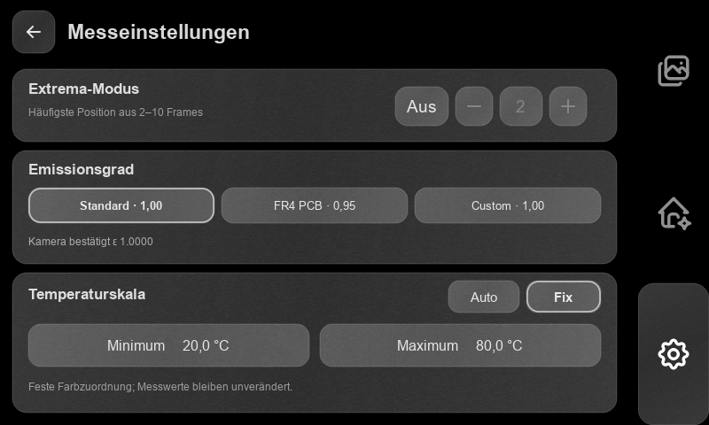

### Network

Open **Settings → Netzwerk**. Press **Aktualisieren** (Refresh) to scan, or **WLAN einschalten** if Wi-Fi is off. Tap a network, enter its password and press **Verbinden** (Connect). For a saved network, leave the password empty to reuse the stored password. The status changes to **Verbunden mit …** when connected.

For an enterprise network, complete the identity and certificate-domain fields presented by the connection form. Tap the active network and choose **Trennen** to disconnect. **Abbrechen** cancels a pending connection.

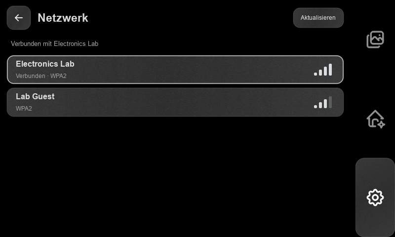

### Storage

Open **Settings → Speicher** to read available capacity and the **System**, **Aufnahmen** (recordings) and **Frei** (free) usage categories. Press **Aktualisieren** to recalculate. Delete unwanted recordings in Gallery or Messungen.

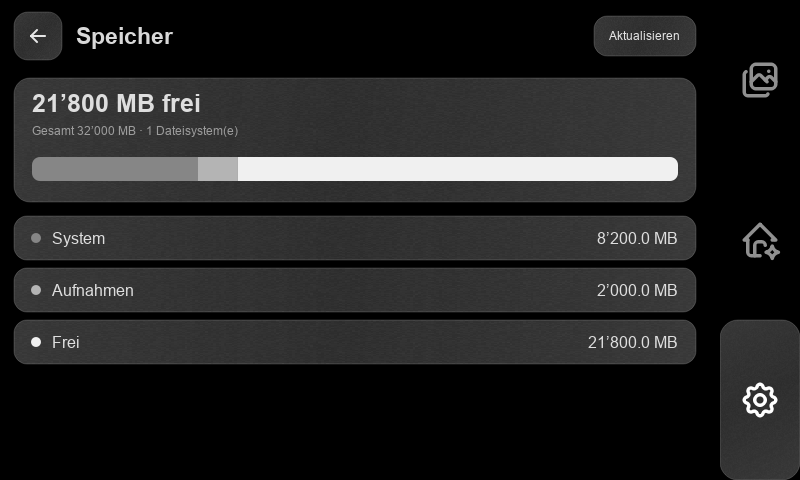

## 5. Gallery

Tap the **stacked-pictures icon** at the top right. Swipe the image **left** for the next recording or **right** for the previous one. The left counters show the current entry and total number of entries.

For photos, the top selector switches between **thermal** (flame), **RGB** (palette) and **radiometric** (measurement-scale icon). In radiometric view, tap the image to place a temperature marker and read that pixel's temperature.

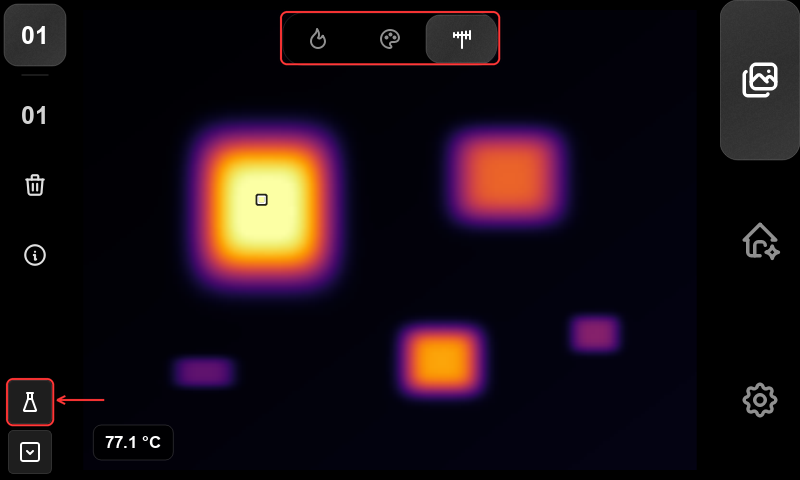

For a video, press the central **Play** control to start playback; press it again to stop. Press Play again to restart from the beginning. Swipe to another entry to stop playback. Press **i** on the left for recording information and again to close it.

Press the **trash** icon and confirm to delete the recording and all associated files. Press **Abbrechen** to keep it.

The lower-left **flask** opens image analysis for a photo with radiometric data. The **file/list icon** below it opens **Messungen**, the combined recording and measurement library.

## 6. Image analysis

Open a radiometric photo in Gallery and press the **flask**. Choose **Punkt** (point), **Rechteck** (rectangle) or **Linienprofil** (line profile). The tool icon below Back (**1** in the point screenshot) returns to this mode selection. Each tool supports up to **five objects**.

### Points

Choose **Punkt**, press **+** (**2**), then tap the desired location. Press **+** again for another point. Tap an existing marker to select it, then drag it to move it. The **Messwerte** box lists the point temperatures; tap its heading to collapse or expand it. **Trash** removes the selected point.

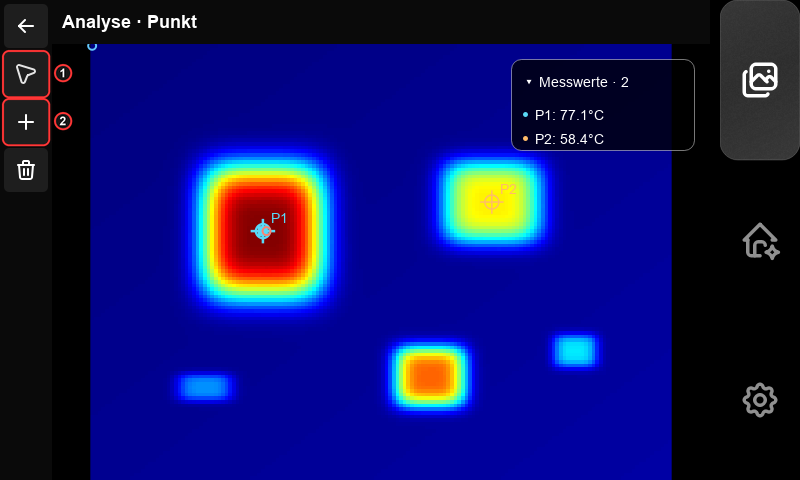

### Rectangles

Choose **Rechteck** and press **+**. Drag across an empty part of the image to define the selected rectangle. Drag its body to move it or a handle to resize it. Tap another rectangle to select it. The values box shows each rectangle's mean temperature.

Press the **split-rectangle icon** to open statistics for the selected rectangle: minimum, maximum, mean, median, standard deviation and quartiles. Press it again to return to the image.

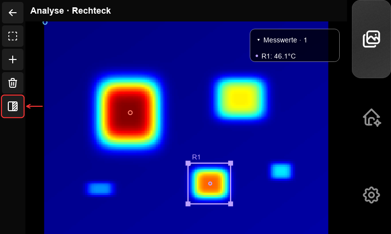

### Line profiles and graph controls

Choose **Linienprofil**, press **+**, and drag across the image to define a line. Move its endpoint handles to adjust it. Press the **split-rectangle icon** to show temperature against distance along the line, in sensor pixels.

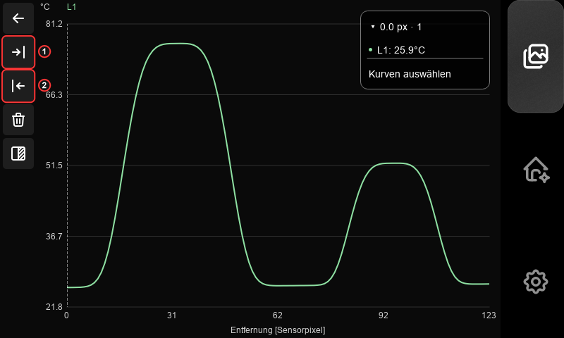

Tap or drag on the graph to position the vertical cursor. **Messwerte** shows the values at that position. Press **Kurven auswählen**, select the curves to display and press **Fertig** (Done).

To evaluate an interval, position the cursor at its first boundary and press **Bereich Start** (upper arrow-to-bar icon); position it at the second boundary and press **Bereich Ende** (lower arrow-to-bar icon). Press the **split-rectangle icon** for interval statistics. In a graph, **Trash** clears the interval; it does not delete the source measurement. Back returns from a line graph to its image.

### Keeping and exporting results

Edits in the image editor remain in the current analysis session. The editor has no Save or Export control in App 0.31.1. To export an existing saved analysis, return to **Messungen**, select it and press **Export**. This exports the objects stored in that saved analysis. Transfer the complete result using **An PC**.

## 7. Temperature history

A temperature history records numerical temperatures for selected points and rectangles over time.

1. On **Home**, double-tap the house, then press the bottom-right **clock/history** icon.
2. Select the **point** tool and tap the image to add points. Select the **rectangle** tool and drag to add areas. Tap and drag existing objects or their handles to adjust them.
3. Open the **object-list icon** to select, rename or delete an object. Return with Back, then press **Weiter** (Next).

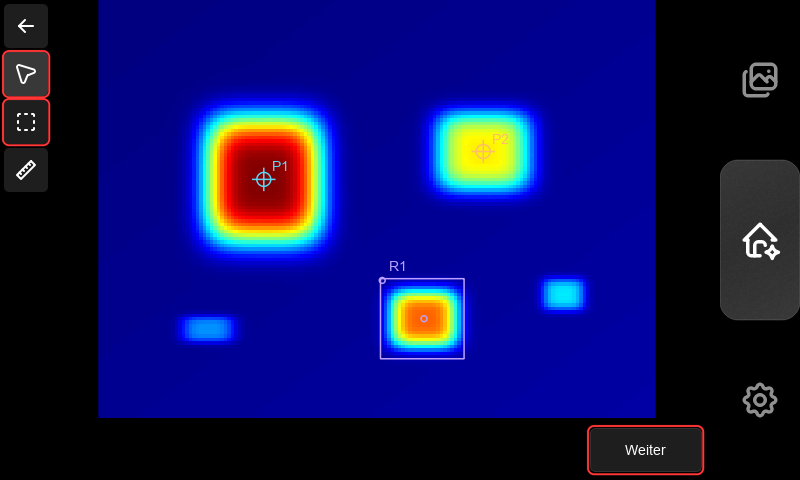

4. Tap **Name** to name the recording. Tap **Abtastrate** to enter a sampling rate of **0.05–8.7 Hz**. The interval is **1 / rate**: 1 Hz = 1 s, 0.2 Hz = 5 s, 0.05 Hz = 20 s.
5. Under **Länge** (Length), select **Definiert** and enter a duration as **MM:SS** or **HH:MM:SS**, or select **Offen** to record until manually ended.
6. Enable **FFC vor Messbeginn** to perform flat-field correction followed by **60 seconds of stabilisation** before recording.
7. Press **Weiter**, review the summary and press the green **START** button.

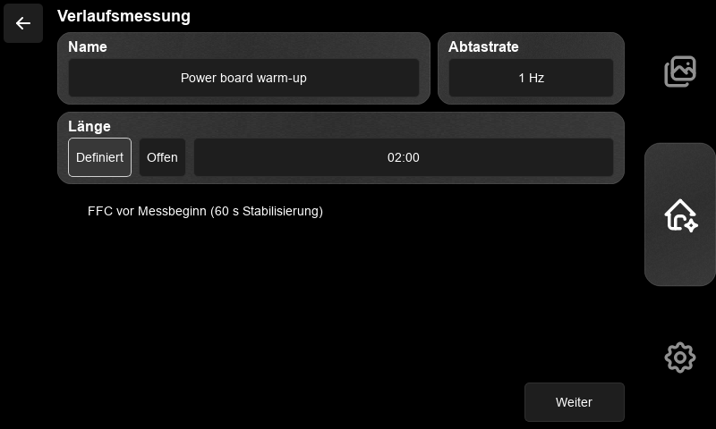

Keep the camera and target in position. The counter shows recording time and, for a defined run, the target duration. A defined run finishes automatically. Manual pauses do not count towards recording duration. If the thermal camera loses valid data, acquisition waits automatically and records the gap.

To finish early or end an open run, press **Pause**, then **Beenden** (End). **Fortsetzen** resumes a paused run. Beenden is enabled while paused.

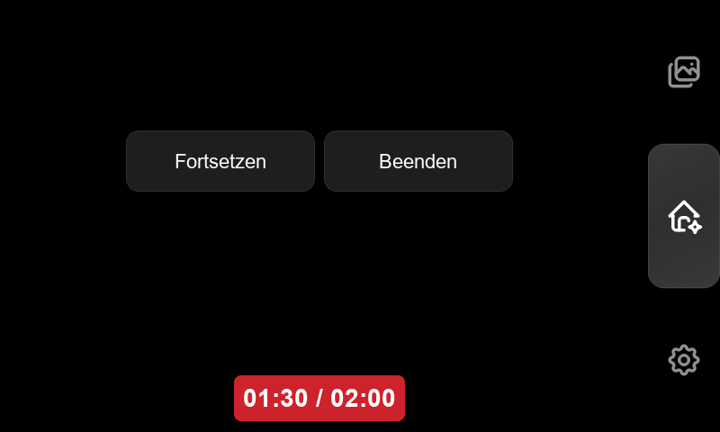

Wait for **Messung beendet** (Measurement ended), then press **OK** to open Messungen. Select the recording and press **Öffnen** to display its graph.

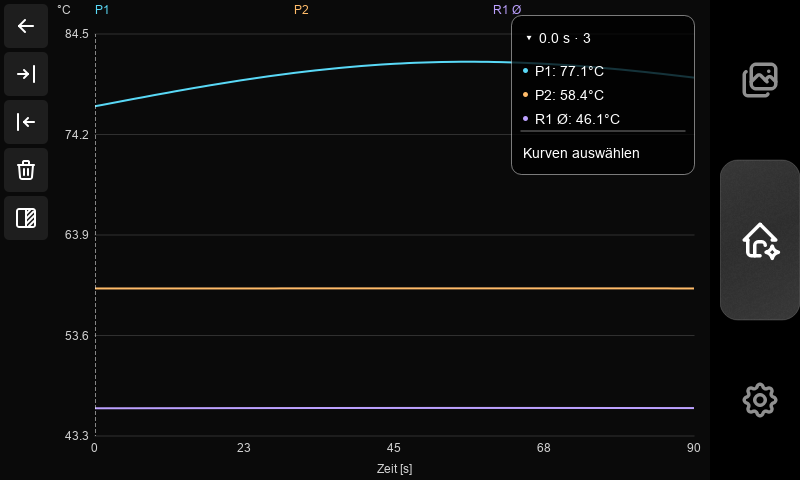

Use the graph cursor, curve selector and Start/End boundaries as described under [image analysis](#6-image-analysis). Rectangle curves include mean, minimum and maximum; minimum and maximum are initially hidden. The **split-rectangle icon** switches between graph and statistics. Statistics cover the selected interval, or the full recording when no complete interval is selected. Scroll down for additional objects and values.

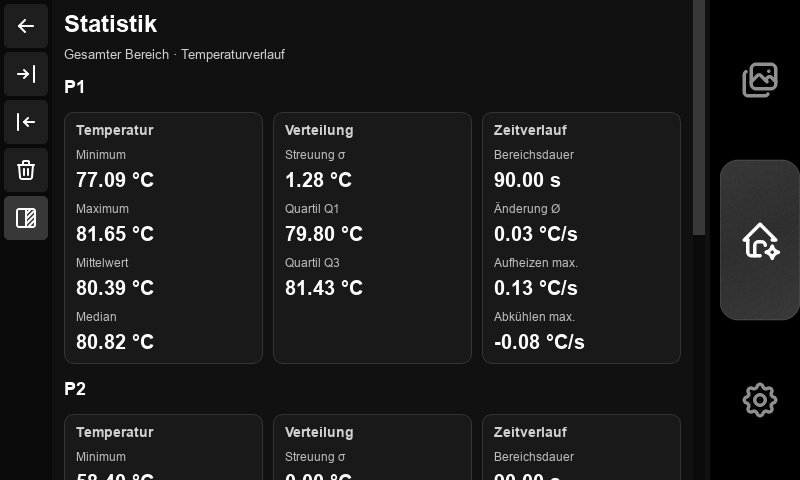

## 8. Saved measurements

Open **Settings → Messungen**, or press the lower-left file/list icon in Gallery. The library contains saved image analyses, temperature histories, photos and videos.

Tap a row to select or deselect it. Selection is cumulative: deselect other rows before opening one entry. The header's **select-all icon** selects or clears all entries.

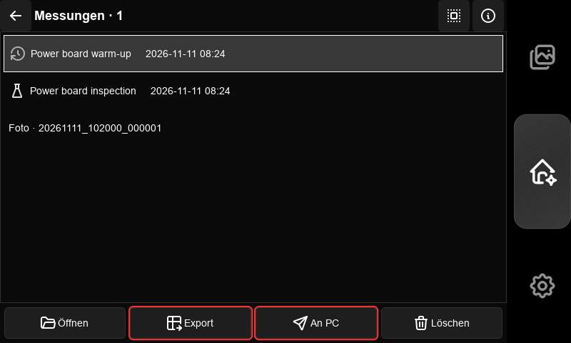

| Action | Result |
|---|---|
| **Öffnen** | Open the single selected entry. Analyses open with their stored objects; histories open as graphs. |
| **Details** (i) | Show the selected entry's files. For a measurement, **Umbenennen** changes its name. |
| **Export** | Generate exports for selected analyses or completed histories. Select only measurement entries to enable it. |
| **An PC** | Package the selected entries for computer transfer. |
| **Löschen** | Delete selected entries and their associated files after confirmation. |

Analysis exports contain annotated PNG/JPEG images, results CSV, line-profile CSV and graphs, and metadata. History exports contain measurements CSV, graph images, quality/pause events and metadata. Export first, then use **An PC** to include these files in the transfer. Back returns to the page from which the library was opened.

## 9. Transfer to a computer

1. Connect SPOT and the computer to the **same Wi-Fi network**. Finish active recordings.
2. Open **Messungen**, select the required entries and press **An PC**. Wait for the ZIP package, HTTPS address and one-time code to appear. Keep this page open.
3. Press **Zertifikat speichern** (Save certificate). SPOT writes the session certificate to **DCIM/TransferTrust/**. Copy the `.cer` file to the computer through a trusted file-transfer path, such as a USB storage device. **Sicherheitsdetails** shows the certificate fingerprint and ZIP hash.

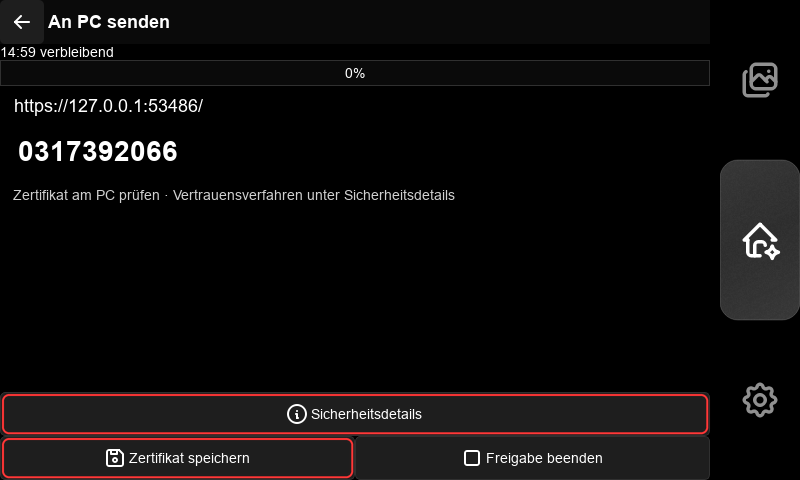

4. On Windows, calculate the certificate's SHA-256:

   ```powershell
   Get-FileHash .\SPOT-<session>.cer -Algorithm SHA256
   ```

   Compare the full hash with **CA SHA-256** on SPOT. Open the certificate, choose **Install Certificate → Current User → Place all certificates in the following store → Trusted Root Certification Authorities**, and confirm the Windows trust prompt.
5. Open the **exact HTTPS address displayed on SPOT** in the computer's browser. Enter the displayed **ten-digit one-time code**, then download the ZIP. If certificate verification fails, correct the certificate trust, address or device clocks before continuing.
6. Compare the downloaded ZIP's hash with **ZIP SHA-256** under Sicherheitsdetails:

   ```powershell
   Get-FileHash .\spot-transfer.zip -Algorithm SHA256
   ```

   Extract the ZIP. `TRANSFER-MANIFEST.json` lists its files, sizes and hashes. The package contains complete selected recordings and measurement folders, including generated exports.
7. Press **Freigabe beenden** (End sharing) on SPOT. Remove this session's SPOT transfer certificate from the computer's Current User trusted-root store.

Sharing expires after **15 minutes**. Retry an interrupted download in the same browser before expiry. A new sharing session creates a new certificate and code. Transfer leaves the original files on SPOT.

## 10. Software updates

Connect Wi-Fi, finish recordings and close active transfers. Open **Settings → Software-Updates**, then press **Nach Updates suchen** (Check for updates). The separate **SPOT App** and **SPOT OS** cards show installed and available versions. Scroll inside the page to see the complete OS card.

Leave **Pre-Releases bewusst einschliessen** unchecked for stable releases. Enable it before checking to include prereleases.

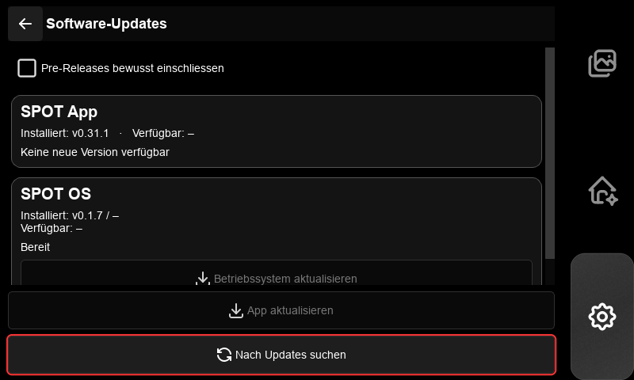

- **App:** press **App aktualisieren**, review the version and confirm. SPOT downloads and checks the package, then restarts the application. If activation is waiting for another operation to finish, complete that operation and press **Anwendung neu starten**. **App-Download abbrechen** cancels preparation before activation.
- **OS:** press **Betriebssystem aktualisieren** to download and prepare the update. Confirm the installation prompt. If the package is already prepared, press **Installation bestätigen**. SPOT updates the OS services and restarts the SPOT session; a full Raspberry Pi reboot is not required.

The centred popup shows progress. Keep power connected until the live interface returns. If an update fails, read the popup message, resolve the reported cause and check again. SPOT restores the previous installation when activation fails.

## 11. Power and energy saving

Leave recording mode, then **hold the Home icon for about 0.7 seconds**. Choose an action and press **Bestätigen** (Confirm); **Abbrechen** returns to the menu. The close icon dismisses it.

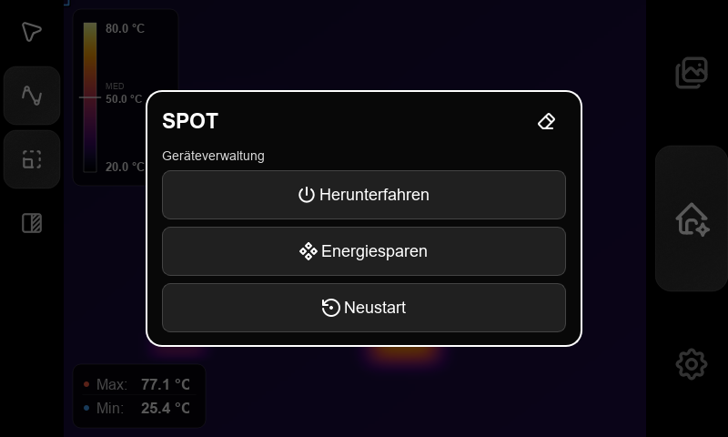

| Action | Operation |
|---|---|
| **Herunterfahren** | Shut down SPOT. Wait for shutdown to finish before removing power. |
| **Neustart** | Restart the device and return to SPOT. |
| **Energiesparen** | Enter standby: pause camera processing and blank the interface. Backlight control follows the device's display profile. **Double-tap the screen** to wake; wait for camera readings to return. |

Finish active recordings, measurements, updates and transfers before confirming a power action. If SPOT reports an operation in progress, finish it and try again.
